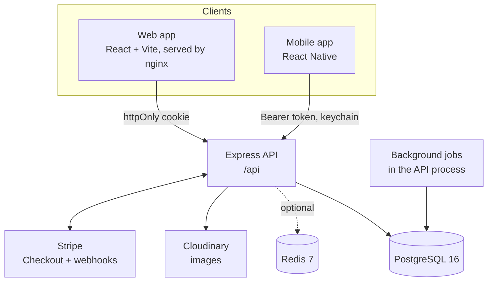
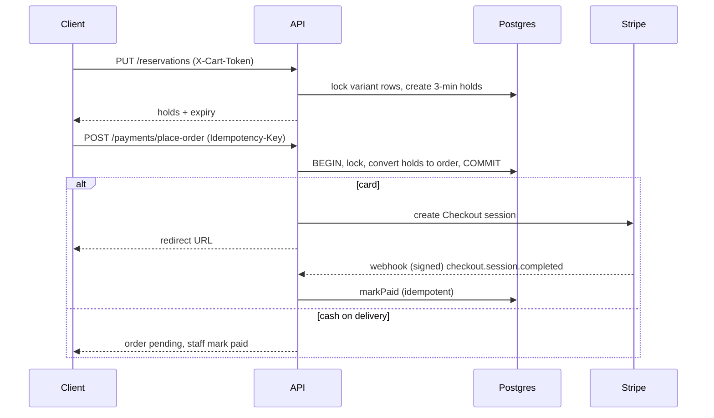
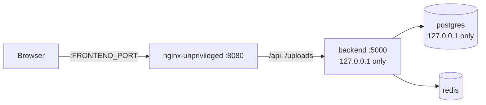

# Architecture

How the system is put together and why. For product scope see [PRD.md](PRD.md); for visual rules see [DESIGN_SYSTEM.md](DESIGN_SYSTEM.md); for setup and commands see [README.md](README.md) and [CLAUDE.md](CLAUDE.md). The code is the final authority.

## 1. System context



Three independent npm projects (no root workspace) share one API:

| Project | Stack | Role |
| --- | --- | --- |
| `backend/` | Express 4, plain CommonJS, no build step | The only place business rules live |
| `frontend/` | React 18, Vite 8, TypeScript, Tailwind 4, React Router 7, Redux Toolkit | Storefront and back office in one SPA |
| `mobile/` | React Native 0.87, TypeScript, React Navigation, Redux Toolkit | Storefront and back office |

**Key decision:** clients are thin. They render what the API says is allowed (`allowed_next`, `can_cancel`) and never hard-code status lists or business rules. This keeps web and mobile consistent.

## 2. Backend

### 2.1 Entry points

- `src/app.js` builds the Express app and mounts every router under `/api`. Tests import this.
- `src/index.js` only starts things: exits if `JWT_SECRET` is unset, starts the background jobs, listens, and on SIGTERM/SIGINT finishes in-flight requests and closes the DB pool.
- The Stripe webhook is mounted **before** `express.json()` because signature verification needs the raw body.
- `trust proxy 1`: the API sits behind nginx, so rate limits key on the real client address.

### 2.2 Layers

```
routes/       validate input, call utils, shape responses
middleware/   auth, upload, idempotency
utils/        business rules (the real logic)
config/       PostgreSQL, Redis, Stripe, Cloudinary clients
db/           schema.sql + migrations/
```

Routes: `auth`, `setup`, `categories`, `products`, `reservations`, `payments`, `stripeWebhook`, `orders`, `returns`, `dashboard`, `users`, `notifications`.

**Rule:** routes stay thin. Anything that decides money, stock or status lives in `utils/`.

| Module | Responsibility |
| --- | --- |
| `orderStatus.js` | The only definition of allowed order status transitions |
| `orderCancel.js` | Every cancellation path (customer and staff): restock plus refund in one transaction |
| `refunds.js` | All money going back; caps at `total - refunded_amount`; Stripe called last, before COMMIT, with an idempotency key |
| `inventory.js` | Restocking (sums quantities per variant) |
| `reservations.js` | 3-minute cart holds keyed by `X-Cart-Token`; renewal; expiry job |
| `stripeOrders.js` | Keeps card orders in sync with Stripe: `markPaid`, `cancelUnpaid`, `refreshOrder`, sweeper |
| `variants.js` | Product options and variant handling |
| `notifications.js` | `createNotification` (user), `notifyAdmins` (staff) |
| `cache.js` | Redis cache with generation-based invalidation |
| `tx.js` | `withTransaction` helper |
| `pagedQuery.js` | `Filters` and `paginate` |
| `validate.js` | Request checks, `pagination()`, `uuidParam`, `isUuid` |
| `storeSettings.js` | `getStoreSettings(client?)` |
| `safeErr.js` | Non-leaking 500 responses |
| `format.js` | `formatMoney`, `shortId` |

### 2.3 Authentication and authorization

- JWT, read from the `token` httpOnly cookie (web) or `Authorization: Bearer` (mobile). `X-Client: mobile` makes login/register return the token in the body.
- `requireRole('admin','staff')` and `requireStaff` guard back-office routes; `isStaff(user)` for inline checks. Never inline role arrays.
- The first registered user becomes `admin`.
- Login does equal work whether or not the email exists.

### 2.4 Transactions and concurrency

- Multi-step writes use `withTransaction(async (client) => …)`: COMMIT on return, ROLLBACK on throw, client always released.
- Rows are locked with `SELECT … FOR UPDATE` (stock checks, order changes).
- To refuse mid-transaction, throw a small domain error (`OrderConflict`, `RefundError`, `ReturnRejected`, `OrderRejected`) carrying an HTTP status; the route maps it to a response. Never COMMIT a half-done write.
- **Optimistic concurrency** for admin status changes: `expected_status` mismatch returns 409 with the fresh order.
- **Idempotency:** `POST /payments/place-order` honours `Idempotency-Key` (`middleware/idempotency.js`, stored 24 h in `idempotency_keys`). Stripe refunds use their own idempotency keys.

### 2.5 Listing and validation conventions

- Lists build `WHERE` with `Filters` and fetch through `paginate({ select, table, joins, filters, orderBy, ...pagination(req.query) })`, which runs count and page in parallel and returns `{ rows, total, page, pages }`.
- Path IDs are validated before querying (`router.param('id', uuidParam(...))` or `isUuid()`), so a bad UUID gives 404 instead of a Postgres 500. `UUID_RE` is not redefined locally.

### 2.6 Background jobs

Both run inside the API process and start from `index.js`:

| Job | Purpose |
| --- | --- |
| `reservations.startExpiryJob()` | Frees expired stock holds |
| `stripeOrders.startSweeper()` | Settles card orders whose webhook never arrived; expires unpaid checkouts after 30 minutes |

Both are safe to run repeatedly because their updates are keyed on state (for example `payment_status = 'unpaid'`).

## 3. Data

### 3.1 PostgreSQL

`backend/src/db/schema.sql` is the single source of truth and **must stay idempotent**: `db:init` runs it in full on every start. New changes are appended to the end of `schema.sql` and copied to `src/db/migrations/` for reference (there is no migration runner).

Tables by group:

| Group | Tables |
| --- | --- |
| Store | `store_settings` |
| People | `users` |
| Catalog | `categories`, `subcategories`, `products`, `product_images`, `product_options`, `product_variants` |
| Selling | `stock_reservations`, `orders`, `order_items`, `idempotency_keys` |
| Returns | `returns`, `return_items` |
| Alerts | `notifications` |
| History | `legacy_product_stock_sku` |

Design points:

- **Stock lives on `product_variants`.** Every product has at least a default variant (`options = '{}'`). Order lines reference `variant_id`.
- One return per order, enforced by a unique index.
- `IF NOT EXISTS` on an index silently skips when the *name* is taken, even by a different index; use a new name when changing an index.

### 3.2 Redis (optional)

`utils/cache.js` is Redis-backed, but every call swallows errors, so the API runs without Redis (it logs `Redis error (non-fatal)` and goes to the database).

- Read through `cache.cached(namespace, id, ttl, load)`. Namespaces: `products`, `dashboard`, `categories`, `setup`.
- **Invalidation is O(1):** one `INCR` bumps the namespace generation; old keys expire on their TTL. Never SCAN or delete by pattern.
- After COMMIT, call `invalidateProducts()` (stock, availability, catalog), `invalidateDashboard()` (orders, revenue, customers), `invalidateCategories()`, or `invalidateSetup()`.
- Product pages cache for 30 s because they show live stock.

### 3.3 Images

Cloudinary when configured, local disk otherwise (development only). `middleware/upload.js` checks file content, not just extension or MIME header.

## 4. Key flows

### 4.1 Cart hold and checkout



Three paths can mark a card order paid: the webhook, the customer returning from Checkout (`refreshOrder`), and the sweeper. All go through the same idempotent `markPaid`.

### 4.2 Order lifecycle

`pending → paid → processing → shipped → delivered`, or `cancelled`. Transitions are defined only in `orderStatus.js`; responses include `allowed_next` (staff) and `can_cancel` (owner). `shipped` requires a tracking number. Delivered and cancelled are final. Cancellation is allowed from pending, paid and processing (customers only while pending or paid).

### 4.3 Cancellation and refunds

Customer `POST /orders/:id/cancel` and staff `PUT /orders/:id/status → cancelled` both call `orderCancel.js`:

1. Open a transaction, lock the order.
2. Restock items.
3. Compute the refund (capped by `total - refunded_amount`).
4. Call Stripe **last, before COMMIT**, with an idempotency key.
5. If Stripe fails, ROLLBACK: nothing changed.

Cash-on-delivery refunds are bookkeeping only.

### 4.4 Returns

Only for `delivered` orders, one per order, inside `store_settings.return_window_days`. `requested → approved | rejected | refunded`; `approved → refunded`. Refunding can restock the returned lines (or the whole order if none were listed).

## 5. Web client (`frontend/src`)

| Area | Approach |
| --- | --- |
| Routing | React Router 7. Back office and setup wizard are `React.lazy` routes in `App.tsx`; keep new admin pages lazy |
| State | Redux Toolkit for cart and auth only; server data is not mirrored into Redux |
| Data loading | `hooks/useApiGet.ts` (refetch on url/params change, drops stale responses, `loading`, `reload()`, `setData()`), not `fetchX()` in `useEffect`. Effects that must fetch use an `ignore` flag |
| HTTP | axios instance in `api/index.ts`: `withCredentials`, `X-Cart-Token`, 401 → `/login`, `errorMessage(err, fallback)` |
| Store settings | `hooks/useStoreSettings.ts`: one shared `/setup/status` request; call `refreshStoreSettings()` after edits |
| Cart | `ShopLayout` owns the `CartDrawer` (native `<dialog>`); pages call `openCart` from `ShopOutletContext`; add via `hooks/useAddToCart.ts`; holds via `hooks/useReservations.ts` |
| Shared helpers | `utils/pricing.ts` (`formatPrice`, `cartTotals`), `utils/orderDisplay.ts` (badges, `shortId`) |
| Types | `types.ts` mirrors `mobile/src/types.ts`; no `any` |
| Styling | Tailwind 4 in CSS (`@theme`, `@utility`) via `@tailwindcss/vite`; no `tailwind.config.js` or PostCSS config |
| Role-shared pages | e.g. `OrderDetail.tsx` serves customers and staff via an `isCustomer` prop |
| Dev | Vite on :5173 proxies `/api` and `/uploads` to :5000 |

Component files export only components (Fast Refresh); shared logic goes in plain modules.

## 6. Mobile client (`mobile/src`)

- Typed endpoint wrappers in `api/index.ts` over `api/client.ts` (Bearer token from the keychain, `X-Client: mobile`).
- React Navigation (`navigation/RootNavigator.tsx`), Redux Toolkit (cart, auth, settings), theme tokens in `theme/index.ts`.
- Backend address chosen by `MODE` in `src/config.ts` (default `reverse` needs `adb reverse tcp:5000 tcp:5000` on Android).
- Jest needs ESM packages in `transformIgnorePatterns` and native modules mocked in `jest.setup.js`.

## 7. Deployment

Docker Compose runs four services: `postgres` (16-alpine), `redis` (7-alpine), `backend`, `frontend`.



- The backend container runs `db:init` before `node src/index.js`.
- `DB_PASSWORD`, `REDIS_PASSWORD` and `JWT_SECRET` use `${VAR:?…}`: compose refuses to start without them. No fallback defaults.
- Backend and Postgres ports bind to `127.0.0.1`. Publishing them on all interfaces would let clients spoof `X-Forwarded-For` and bypass rate limits.
- Images use Node 24 LTS; production deps via `npm ci --omit=dev`. Containers run non-root with `no-new-privileges`; health checks use busybox `wget`.
- Locally the root `.env` maps Postgres to host port **5433** to avoid a native install.

## 8. Testing

| Layer | Tool | Notes |
| --- | --- | --- |
| Backend unit | `node:test` (`npm run test:unit`) | Business rules, no DB. Stripe refunds use a fake client (`test/unit/fakes.js`) |
| Backend API | `node:test` (`npm test`) | Needs `TEST_DATABASE_URL`, else skipped. Wipes and rebuilds the schema each run; `helpers.js` refuses any DB name without `test`. Files run serially (`--test-concurrency=1`) on a random port. Card payments are off |
| Web | Vitest + jsdom | `npm test` |
| Mobile | Jest | `npx jest __tests__/…` |

Static checks: `npm run typecheck` and `npm run lint` (web), `npx tsc --noEmit` and `npm run lint` (mobile).

## 9. Cross-cutting decisions

| Decision | Reason |
| --- | --- |
| Business rules only in `utils/` | One source for web, mobile and tests |
| Stripe called last, before COMMIT | A failed refund rolls everything back; no half-refunded states |
| Idempotent state transitions keyed on current state | Webhook, return-visit and sweeper can race safely |
| O(1) cache invalidation by generation | No key scans; stale keys simply expire |
| Redis optional | Dev and small deployments work without it |
| Stock on variants, holds in a table | Concurrency-safe, inspectable, expirable by a job |
| Idempotent `schema.sql`, no migration runner | Simple single-step upgrade on every start |
| Thin clients driven by `allowed_next` / `can_cancel` | No drift between web and mobile |
| Secrets have no defaults | A copied example can never run with a known password |

## 10. Known limitations

- Background jobs run in the API process; running several API instances means several sweepers (their updates are idempotent, but this is not leader-elected).
- Notifications are in-app only; no email.
- One store, one currency, one tax rate per deployment.
- The README's older lifecycle diagrams may lag behind `orderStatus.js` and `routes/returns.js`; trust the code.
