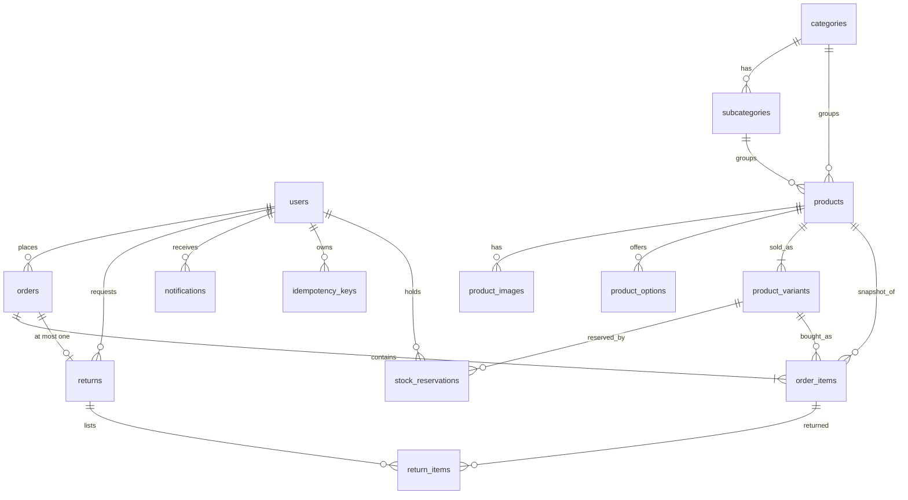

# Database

PostgreSQL 16 schema reference. The source of truth is [backend/src/db/schema.sql](backend/src/db/schema.sql); if this file and the SQL disagree, the SQL wins. For how the API uses the data see [ARCHITECTURE.md](ARCHITECTURE.md).

## 1. Entity relationship diagram

`store_settings` stands alone (a single row of store-wide configuration).

## 2. Conventions

- **Idempotent schema.** `db:init` runs the whole file on every start. Everything uses `CREATE … IF NOT EXISTS`, `ADD COLUMN IF NOT EXISTS` or guarded `DO $$` blocks.
- **Changes** are appended to the end of `schema.sql` **and** copied to [backend/src/db/migrations/](backend/src/db/migrations/) for reference. There is no migration runner.
- **Index names.** `IF NOT EXISTS` skips silently when the *name* is taken, even by a different kind of index. Use a new name when changing an index.
- **IDs.** UUIDs (`gen_random_uuid()`) for users, products, orders, variants and anything customer-facing; `SERIAL` integers for categories, subcategories, product options and store settings.
- **Money** is `DECIMAL(10,2)`; the pg driver returns it as a string.
- **Timestamps.** Most tables use `TIMESTAMP` (no zone); `stock_reservations` and `idempotency_keys` use `TIMESTAMPTZ`.
- **Stock lives on `product_variants`.** `products` has no stock or SKU columns. Every product has at least one variant; a product without options has a single default variant with `options = '{}'`.
- **Enums** are `VARCHAR` plus `CHECK` constraints, not Postgres enum types. Allowed order status changes are defined in `backend/src/utils/orderStatus.js`, not in the database.

## 3. Tables

### store_settings
One row of store-wide configuration, exposed to clients via `/setup/status`.

| Column | Type | Notes |
| --- | --- | --- |
| id | serial PK | |
| name | varchar(255) | required |
| description, address | text | |
| logo_url | varchar(500) | |
| currency | varchar(10) | default `USD` |
| email, phone | varchar | contact details; hidden in the shop when empty |
| tax_rate | decimal(5,2) | default 0 |
| tax_enabled | boolean | default false |
| return_window_days | integer | default 30 |
| timezone | varchar(64) | default `UTC` |
| created_at, updated_at | timestamp | |

### users
| Column | Type | Notes |
| --- | --- | --- |
| id | uuid PK | |
| name | varchar(255) | |
| email | varchar(255) | unique, required |
| password_hash | varchar(255) | |
| role | varchar(20) | `admin` \| `staff` \| `customer`, default `customer`. The first registered user becomes `admin`. |
| is_active | boolean | default true |
| created_at, updated_at | timestamp | |

### categories / subcategories
| Table | Columns |
| --- | --- |
| categories | id (serial PK), name, slug (unique), description, image_url, is_active, created_at |
| subcategories | id (serial PK), category_id → categories (CASCADE), name, slug, description, is_active, created_at. Unique `(category_id, slug)`. |

### products
| Column | Type | Notes |
| --- | --- | --- |
| id | uuid PK | |
| name, slug | varchar(255) | slug unique |
| description | text | |
| price | decimal(10,2) | required; a variant may override it |
| compare_at_price | decimal(10,2) | |
| discount_percent | decimal(5,2) | default 0 |
| discount_active | boolean | default false |
| discount_start, discount_end | timestamp | optional discount window |
| category_id | → categories | `ON DELETE SET NULL` |
| subcategory_id | → subcategories | `ON DELETE SET NULL` |
| is_active | boolean | default true |
| created_at, updated_at | timestamp | |

### product_images
`id` uuid PK, `product_id` → products (CASCADE), `url` varchar(500), `is_primary` boolean, `sort_order` integer, `created_at`.

### product_options
The pickers a product offers, e.g. `Color → {Rojo, Azul}`.

`id` serial PK, `product_id` → products (CASCADE), `name` varchar(50), `"values"` text[], `position`. Unique `(product_id, name)`.

### product_variants
Each sellable combination. **This is where stock and SKU live.**

| Column | Type | Notes |
| --- | --- | --- |
| id | uuid PK | |
| product_id | → products | CASCADE |
| sku | varchar(100) | unique, nullable |
| options | jsonb | `{}` = default variant, otherwise e.g. `{"Color":"Rojo","Talla":"M"}`. Unique with `product_id`. |
| price | decimal(10,2) | `>= 0`; NULL means use `products.price` |
| stock | integer | `>= 0`, default 0 |
| is_active | boolean | default true |
| position | integer | |
| created_at, updated_at | timestamp | |

### orders
| Column | Type | Notes |
| --- | --- | --- |
| id | uuid PK | shown to people as `shortId(id)` |
| user_id | → users | `ON DELETE SET NULL` |
| status | varchar(30) | `pending` \| `paid` \| `processing` \| `shipped` \| `delivered` \| `cancelled`; default `pending` |
| subtotal, total | decimal(10,2) | required |
| discount, tax, shipping | decimal(10,2) | default 0 (shipping is always free today) |
| shipping_address | jsonb | snapshot at order time |
| notes | text | |
| tracking_number, carrier | varchar(100) | required to move to `shipped` |
| payment_method | varchar(20) | default `cod` (cash on delivery); card orders use Stripe |
| payment_status | varchar(20) | `unpaid` \| `paid` \| `canceled` \| `partially_refunded` \| `refunded`; default `unpaid`. No CHECK constraint. |
| stripe_session_id | varchar(255) | indexed |
| stripe_payment_intent | varchar(255) | |
| refunded_amount | decimal(10,2) | not null, default 0; refunds are capped at `total - refunded_amount` |
| created_at, updated_at | timestamp | |

Dashboard revenue is `total - refunded_amount`.

### order_items
A snapshot of what was bought, so history survives product and variant edits or deletion.

| Column | Type | Notes |
| --- | --- | --- |
| id | uuid PK | |
| order_id | → orders | CASCADE |
| product_id | → products | `ON DELETE SET NULL` |
| variant_id | → product_variants | `ON DELETE SET NULL` |
| product_name | varchar(255) | snapshot |
| product_image | varchar(500) | snapshot |
| sku, variant_label | varchar | snapshot, e.g. `Rojo / M` |
| unit_price, discount, total | decimal(10,2) | |
| quantity | integer | |

### returns
At most one per order (unique index), only for `delivered` orders inside `return_window_days`.

| Column | Type | Notes |
| --- | --- | --- |
| id | uuid PK | |
| order_id | → orders | CASCADE |
| user_id | → users | `ON DELETE SET NULL` |
| reason | text | required |
| status | varchar(20) | `requested` \| `approved` \| `rejected` \| `refunded`; default `requested` |
| refund_amount | decimal(10,2) | |
| admin_notes | text | |
| restocked | boolean | not null, default false; whether the refund put items back on sale |
| created_at, updated_at | timestamp | |

### return_items
`id` uuid PK, `return_id` → returns (CASCADE), `order_item_id` → order_items (CASCADE), `quantity`, `reason`. A return with no lines means the whole order.

### stock_reservations
Short cart holds (3 minutes, renewed while the cart is active, expired by a background job). Available stock = `product_variants.stock` minus the sum of non-expired holds.

`id` uuid PK, `product_id` → products (CASCADE), `variant_id` → product_variants (CASCADE, not null), `cart_token` varchar(64) (from the `X-Cart-Token` header), `user_id` → users (`SET NULL`), `quantity` (`> 0`), `expires_at` timestamptz, `created_at`, `updated_at`. Unique `(variant_id, cart_token)`.

### idempotency_keys
Stored responses for `POST /payments/place-order` with an `Idempotency-Key` header (kept 24 hours).

`key` varchar(128), `user_id` → users (CASCADE), `request_hash` varchar(64), `status_code`, `response` jsonb, `created_at` timestamptz. Primary key `(key, user_id)`.

### notifications
`id` uuid PK, `user_id` → users (CASCADE), `type` varchar(50), `title`, `message`, `is_read` (default false), `metadata` jsonb (default `{}`), `created_at`.

### legacy_product_stock_sku
Created only when an old database still has `products.stock` / `products.sku`. It keeps their last values before the columns are dropped. New installs never create it.

## 4. Indexes

| Index | On | Serves |
| --- | --- | --- |
| idx_notifications_user_id | notifications(user_id) | a user's notifications |
| idx_notifications_created_at | notifications(created_at DESC) | newest first |
| idx_orders_user_id | orders(user_id) | "my orders" |
| idx_orders_status | orders(status) | admin filters |
| idx_orders_created_at | orders(created_at DESC) | order lists |
| idx_orders_stripe_session | orders(stripe_session_id) | Stripe webhook and sweeper lookups |
| idx_order_items_order_id | order_items(order_id) | order detail |
| idx_order_items_product_id | order_items(product_id) | "popular" sort |
| idx_order_items_variant_id | order_items(variant_id) | variant history |
| idx_products_is_active | products(is_active) | storefront listing |
| idx_products_category_id | products(category_id) | category filter |
| idx_products_created_at | products(created_at DESC) | newest first |
| idx_product_images_product_id | product_images(product_id, sort_order) | images per product |
| idx_product_variants_product_id | product_variants(product_id) | variants per product |
| idx_returns_user_id | returns(user_id) | "my returns" |
| idx_returns_status | returns(status) | admin filters |
| idx_returns_one_per_order | returns(order_id) **UNIQUE** | one return per order, lookups by order |
| idx_stock_reservations_variant_cart | stock_reservations(variant_id, cart_token) **UNIQUE** | one hold per cart per variant |
| idx_stock_reservations_variant_expires | stock_reservations(variant_id, expires_at) | availability math |
| idx_stock_reservations_product_expires | stock_reservations(product_id, expires_at) | legacy, product-level |
| idx_stock_reservations_cart | stock_reservations(cart_token) | releasing a cart |
| idx_stock_reservations_expires | stock_reservations(expires_at) | expiry job |
| idx_idempotency_keys_created | idempotency_keys(created_at) | cleanup |

## 5. Delete behaviour

| When this is deleted | These rows |
| --- | --- |
| a user | their notifications and idempotency keys are deleted; orders, returns and holds keep the row with `user_id = NULL` |
| a product | images, options, variants and holds are deleted; order lines keep a snapshot with `product_id = NULL` |
| a variant | holds are deleted; order lines keep a snapshot with `variant_id = NULL` |
| a category | its subcategories are deleted; products keep the row with `category_id = NULL` |
| a subcategory | products keep the row with `subcategory_id = NULL` |
| an order | its items and return are deleted (in practice orders are cancelled, not deleted) |

## 6. Where the rules live

The database enforces shape (types, `CHECK`s, uniqueness, foreign keys). Business rules are in `backend/src/utils/`: order status transitions (`orderStatus.js`), cancellation (`orderCancel.js`), refunds (`refunds.js`), restocking (`inventory.js`), Stripe sync (`stripeOrders.js`) and cart holds (`reservations.js`). Multi-step writes use `withTransaction` with `SELECT … FOR UPDATE` row locks.

## 7. Local database

`docker compose up -d postgres redis` publishes Postgres on host port **5433**. Then `cd backend && npm run db:init` applies the schema. API tests use a separate database whose name contains `test` (`TEST_DATABASE_URL`) and **wipe and rebuild its schema on every run**.
