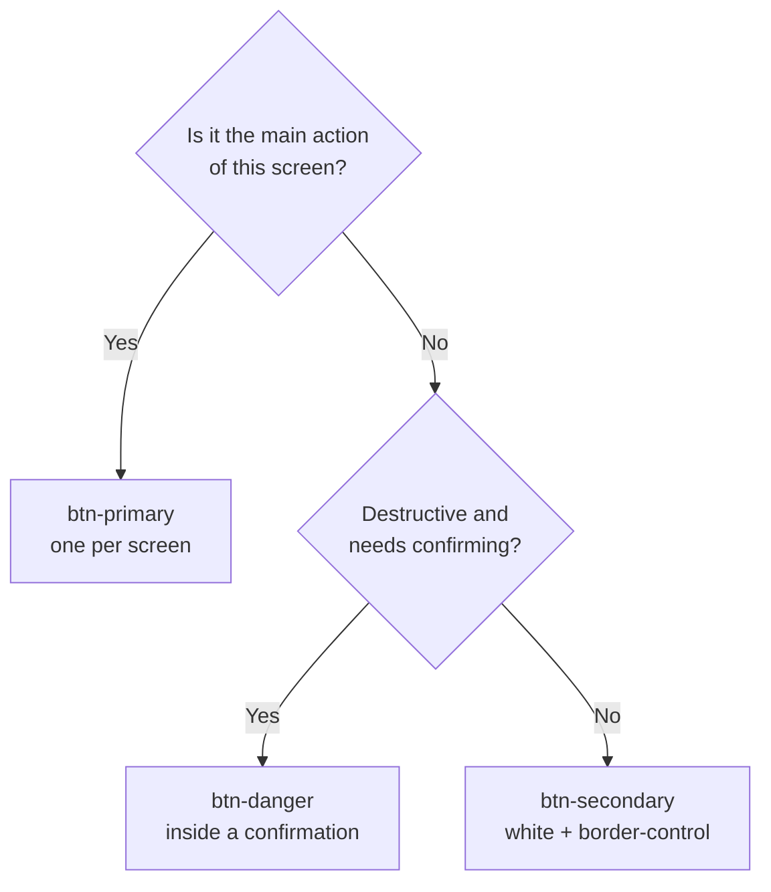
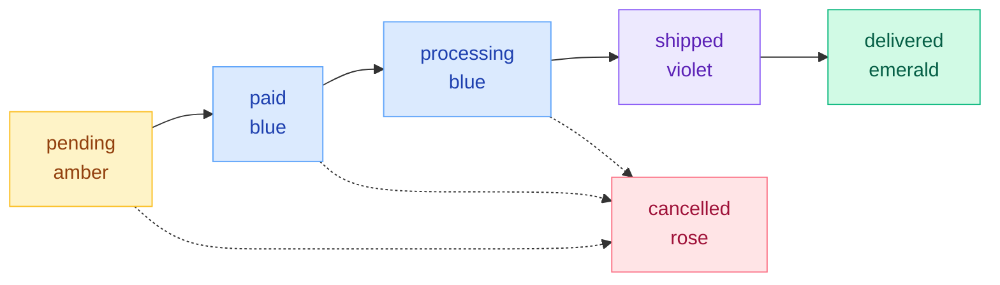

# Design System

Applies to the web app (`frontend/`) and the mobile app (`mobile/`). Web tokens live in `frontend/src/index.css`; mobile tokens live in `mobile/src/theme/index.ts` and mirror the web values. If a value here differs from those files, the files win.

> [!NOTE]
> Swatches are rendered with placehold.co, so they need an internet connection. The hex values next to them are the source of truth.

<p>
  
  
  
  
  
  
  
  
</p>

## At a glance

| | |
| --- | --- |
| **Feel** | Clear, calm, trustworthy. White-label: the merchant's products and logo lead. |
| **Brand colour** | Blue `primary-600` `#2563eb`, one solid action per screen |
| **Type** | Inter on web, system font on mobile |
| **Shape** | Controls `rounded-xl`, cards `rounded-2xl`, badges pills. Cards have a border, not a shadow |
| **Contrast** | Text 4.5:1, control borders and focus 3:1 |
| **Source of truth** | `frontend/src/index.css` and `mobile/src/theme/index.ts` |

**Contents:** [1 Brand](#1-brand-identity) · [2 Colour](#2-colour) · [3 Typography](#3-typography) · [4 Spacing](#4-spacing-radius-elevation) · [5 Components](#5-components) · [6 Layout](#6-layout) · [7 Motion](#7-motion) · [8 Accessibility](#8-accessibility-requirements) · [9 Content](#9-content-rules) · [10 Sync](#10-keeping-it-in-sync)

## 1. Brand identity

**The store is white-label.** Name, logo, tab title and favicon come from Store Settings (`/setup/status`) and are never hard-coded. The design system therefore defines a neutral frame that lets any merchant's products and logo take centre stage.

**Personality:** clear, calm, trustworthy. A tool for buying and for running a shop, not a showcase for the interface.

**Principles**

1. **Products first.** Photos sit in a neutral white frame, are never cropped, and never get a coloured background.
2. **One action per screen.** A single solid `primary-600` button marks the main action. Everything else is quieter.
3. **Colour means something.** Each hue has one job (see section 2.4). Never use a colour for decoration.
4. **Honest copy.** Say only what the code does: shipping is free, returns follow the store's return window, cash on delivery is always offered. No placeholder features, no dead links.
5. **Accessible by default.** Contrast, focus, keyboard and touch rules are requirements, not polish (section 8).
6. **Same product everywhere.** Web and mobile share tokens, status colours and wording.

**Default mark.** Until a logo is uploaded, the favicon is a `primary-600` rounded square (7/32 radius) with a white outlined shopping bag. The uploaded logo replaces it in the tab, header and auth screens (`StoreLogo`, `AuthBrand`).

**Voice.** Plain, short, second person. Sentence case for buttons, labels and headings. Errors say what happened and what to do next. Avoid hype, exclamation marks and jargon.

## 2. Colour

### 2.1 Primary (blue)

Defined in `@theme` in `index.css`.

| Token | Swatch | Hex | Typical use |
| --- | --- | --- | --- |
| `primary-50` |  | `#eff6ff` | Tinted backgrounds, selected rows |
| `primary-100` |  | `#dbeafe` | Badges (paid, processing) |
| `primary-200` |  | `#bfdbfe` | Soft borders |
| `primary-300` |  | `#93c5fd` | Decorative |
| `primary-400` |  | `#60a5fa` | Chart and status bars |
| `primary-500` |  | `#3b82f6` | Focus ring (at 40% opacity) |
| **`primary-600`** | ** | `#2563eb`** | **Main action, links, brand** |
| `primary-700` |  | `#1d4ed8` | Hover, link text on tint |
| `primary-800` |  | `#1e40af` | Pressed, badge text |
| `primary-900` |  | `#1e3a8a` | Rare, deep emphasis |

### 2.2 Neutrals (Tailwind slate)

| Role | Token | Swatch | Hex |
| --- | --- | --- | --- |
| Page background | `slate-50` |  | `#f8fafc` |
| Surface (cards, inputs) | `white` |  | `#ffffff` |
| Subtle fill, hover | `slate-100` |  | `#f1f5f9` |
| Decorative borders (cards, tables) | `slate-200` |  | `#e2e8f0` |
| Body text | `slate-900` |  | `#0f172a` |
| Secondary text on tint | `slate-600` |  | `#475569` |
| Small text on white / page | `slate-500` |  | `#64748b` |
| **Control border** | `control` |  | `#8091a7` |

`control` is the lightest grey that still reaches 3:1 on white and on `slate-50`. Use it for every interactive boundary: inputs, outlined buttons, chips. Card and table borders are decorative and stay `slate-200`. Never use `slate-400` for text.

### 2.3 Semantic colours

| Role | Web | Mobile token | Mobile hex |
| --- | --- | --- | --- |
| Danger / sale | `rose-500` solid, `rose-700` text | `danger` / `dangerSoft` | `#dc2626` / `#fef2f2` |
| Success / in stock | `emerald` / `green` | `success` / `successSoft` | `#15803d` / `#f0fdf4` |
| Warning | `amber` | `warning` / `warningSoft` | `#b45309` / `#fffbeb` |
| Info | `primary` / `sky` | `info` / `infoSoft` | `#0284c7` / `#f0f9ff` |

### 2.4 Colour roles (rules)

- **`primary-600` solid:** the one main action of a screen. Never two on the same screen.
- **White + `border-control`:** secondary actions, filters, inputs.
- **Rose:** sale prices and errors only.
- **Emerald / green:** stock and success only.
- **Amber:** waiting or needs attention.
- **Error and warning text:** use the 700 shades for contrast.
- No gradient KPI cards, no red or yellow (use rose and amber).

**Which button?**



| Do | Don't |
| --- | --- |
| One solid blue button per screen | Two solid blue buttons side by side |
| Rose for a sale price or an error | Rose as decoration |
| Green for in stock and success | Green for a generic accent |
| `slate-500` for small text on white | `slate-400` for any text |
| White + `border-control` for inputs and chips | A pale `slate-200` border on an input |

### 2.5 Status colours

One colour per status, everywhere (`frontend/src/utils/orderDisplay.ts`, `mobile/src/theme`). Roles: amber = waiting, blue = in progress, violet = on its way, emerald = done, rose = stopped.

| Status | Web badge | Bar / dot |
| --- | --- | --- |
| Order `pending` | `amber-100` / `amber-800` | `amber-400` |
| Order `paid` | `primary-100` / `primary-800` | `primary-400` |
| Order `processing` | `primary-100` / `primary-800` | `primary-600` |
| Order `shipped` | `violet-100` / `violet-800` | `violet-500` |
| Order `delivered` | `emerald-100` / `emerald-800` | `emerald-500` |
| Order `cancelled` | `rose-100` / `rose-800` | `rose-400` |
| Return `requested` | `amber-100` / `amber-800` | |
| Return `approved` | `primary-100` / `primary-800` | |
| Return `rejected` | `rose-100` / `rose-800` | |
| Return `refunded` | `emerald-100` / `emerald-800` | |
| Unknown | `slate-100` / `slate-800` | `slate-300` |

**Order lifecycle with its colours** (allowed transitions come from `orderStatus.js`; clients never hard-code them):



Returns: `requested` (amber) → `approved` (blue) → `refunded` (emerald), or `rejected` (rose).

> [!WARNING]
> Known drift: the mobile `statusColor` map currently shows `paid` and `refunded` in the info (sky) tint and `shipped` in `primaryDark`, and `approved` in green, while web uses the table above. Align mobile to web when touching either.

## 3. Typography

**Typeface:** [Inter](https://fonts.google.com/specimen/Inter), weights 300, 400, 500, 600, 700, 800, linked from `frontend/index.html` (not imported in CSS).

**Web stack:** `'Inter', system-ui, -apple-system, BlinkMacSystemFont, 'Segoe UI', sans-serif`, with `antialiased` rendering on `body`.

**Mobile:** the platform system font (San Francisco on iOS, Roboto on Android).

**Weights in use**

| Weight | Use |
| --- | --- |
| 400 | Body copy |
| 500 | Labels, nav |
| 600 | Buttons, badges, table headers, emphasis |
| 700 to 800 | Page titles, prices, KPI values |

**Web scale:** Tailwind defaults. Body and inputs `text-sm`, badges `text-xs`, page titles `text-2xl` and up.

**Mobile scale** (`font` in the theme file)

| Token | Size |
| --- | --- |
| `xs` | 11 |
| `sm` | 13 |
| `md` | 15 |
| `lg` | 17 |
| `xl` | 22 |
| `xxl` | 28 |

**Hierarchy at a glance**

| Level | Web | Weight | Colour |
| --- | --- | --- | --- |
| Page title | `text-2xl`+ | 700–800 | `slate-900` |
| Price, KPI | `text-xl`+ | 700–800 | `slate-900` (rose when on sale) |
| Section heading | `text-lg` | 600 | `slate-900` |
| Body, inputs | `text-sm` | 400 | `slate-900` |
| Label, nav | `text-sm` | 500 | `slate-700` |
| Badge, caption | `text-xs` | 600 / 400 | status colour / `slate-500` |

**Rules**

- Small text is `slate-500` on white or `slate-50`, `slate-600` on tinted backgrounds. Body is `slate-900`.
- Minimum 4.5:1 contrast for text.
- Format money through `formatPrice` (`utils/pricing.ts`), never by hand.
- Order references use `shortId`: first 8 characters, uppercase.

## 4. Spacing, radius, elevation

**Web:** Tailwind's 4px scale.

**Mobile spacing** (`spacing`): `xs` 4, `sm` 8, `md` 12, `lg` 16, `xl` 24, `xxl` 32.

| Element | Web | Mobile |
| --- | --- | --- |
| Buttons, inputs | `rounded-xl` | `radius.md` 10 |
| Cards | `rounded-2xl` | `radius.lg` 14 |
| Badges, pills | `rounded-full` | `radius.pill` 999 |
| Small controls | | `radius.sm` 6 |

**Elevation:** minimal. Cards use a 1px `slate-200` border, no shadow. Buttons use `shadow-xs`, rising to `shadow-md` on hover for primary. Drawers and modals use the native `<dialog>` backdrop. Mobile card shadow: `#0f172a` at 6% opacity, radius 8, offset (0, 2), elevation 2.

**Product grid:** 2 / 3 / 4 / 5 columns from phone to wide screens. Home sections show whole rows only.

## 5. Components

Web utilities are defined with `@utility` in `index.css`.

| Component | Spec |
| --- | --- |
| `btn-primary` | `primary-600` fill, `primary-700` hover, `primary-800` pressed, white text, semibold, `py-2.5 px-5`, `rounded-xl`, 50% opacity when disabled |
| `btn-secondary` | White fill, `border-control`, `slate-700` text, `slate-50` hover |
| `btn-danger` | `rose-500` fill, `rose-600` hover, white text. For destructive confirmations only |
| `input` | Full width, `border-control`, `rounded-xl`, `px-4 py-2.5`, `text-sm`, placeholder `slate-500`, focus ring `primary-500/40` plus `primary-600` border |
| `card` | White, `rounded-2xl`, `slate-200` border, `p-6` |
| `badge` | Inline pill, `px-2.5 py-0.5`, `text-xs`, semibold. Pair with a colour from section 2.5 |
| `skip-link` | Hidden until focused, then fixed top-left, high contrast |
| `scrollbar-hide` | Hides scrollbars for horizontal chip rows |

**Anatomy**

```text
btn-primary      ┌──────────────────┐   primary-600 fill, white text
                 │   Place order    │   rounded-xl, py-2.5 px-5, shadow-xs
                 └──────────────────┘   hover primary-700 · pressed primary-800

btn-secondary    ┌──────────────────┐   white fill, border-control
                 │   Keep shopping  │   slate-700 text, hover slate-50
                 └──────────────────┘

input            ┌──────────────────┐   border-control, rounded-xl, text-sm
                 │ Email            │   placeholder slate-500
                 └──────────────────┘   focus: primary-600 border + ring primary-500/40

card             ╭──────────────────╮   white, rounded-2xl, slate-200 border, p-6
                 │                  │   no shadow
                 ╰──────────────────╯

badge            ( Shipped )            rounded-full, px-2.5 py-0.5, text-xs semibold
```

Shared components

- **`ProductImage`** (web and mobile): neutral white frame, `object-contain`, lazy by default, `priority` for the main image of a page, category-icon placeholder when there is no photo or it fails. Do not hand-roll `` for products.
- **`Modal` and `CartDrawer`:** native `<dialog>`. The drawer closes on navigation; scroll never leaks to the page behind.
- **`Pagination`:** under every paged list.
- **`HoldBanner` / `HoldNotice`:** stock-hold countdown and short or sold-out lines.
- **`VariantPicker`:** option selection on product pages.
- **Charts:** Recharts, using the section 2 colours only.

## 6. Layout

- Page background `slate-50`; content sits on white cards.
- Mobile first. Phone width has no horizontal page scroll.
- Shop and back office share the same rules. The back office is lazy-loaded.
- Cart adds are confirmed by opening the drawer, not a toast. Toasts are for errors and background results (`errorMessage(err, fallback)`).

## 7. Motion

- Transitions are short (`duration-150`) and limited to colour, shadow and transform.
- `prefers-reduced-motion: reduce` collapses all animation and transition durations and disables smooth scrolling (set globally in `index.css`).
- Nothing moves without a reason; no decorative animation.

## 8. Accessibility requirements

- Text 4.5:1; interactive borders and focus indicators 3:1.
- Every interactive element is reachable and operable by keyboard, with a visible focus ring.
- Icon-only buttons and links have an `aria-label` naming their target, for example `Delete ${product.name}`.
- Actions are visible without hover so touch and keyboard users can find them.
- Toggle and filter chips set `aria-pressed`. In forced-colours mode a pressed chip gets a 2px `Highlight` outline, since background colours are dropped.
- Skip link on `ShopLayout` and `AdminLayout`.
- Status is never colour alone: badges always carry the status text.
- Touch targets are comfortable on mobile (aim for 44pt or more).

## 9. Content rules

- Shipping is free on every order; do not mention shipping fees.
- Return copy uses `store_settings.return_window_days`.
- Cash on delivery is always offered; card is offered only when Stripe is configured.
- Contact details come from Store Settings and are hidden when empty.
- No wishlists, chat, memberships, "recommended for you" or footer links without a working feature behind them.
- "Best Sellers" means `GET /products?sort=popular`.

## 10. Keeping it in sync

- Change a colour or radius in `index.css`, then mirror it in `mobile/src/theme/index.ts`, then update this file.
- Do not add per-page status colour maps or hand-written `$` plus `toFixed(2)`; use `orderDisplay.ts` and `pricing.ts`.
- Mobile code is not Prettier-formatted; match surrounding style (no spaces inside braces) instead of reformatting.
