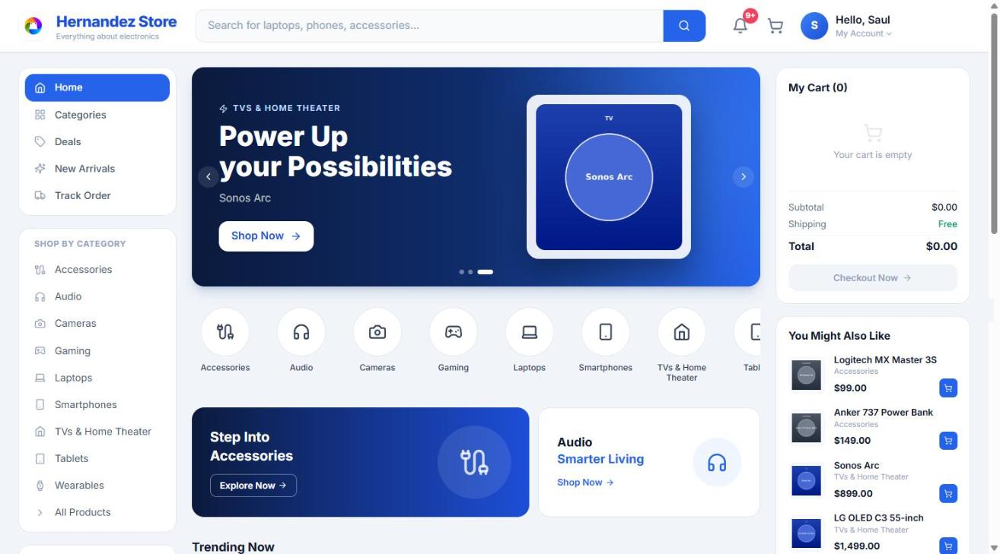
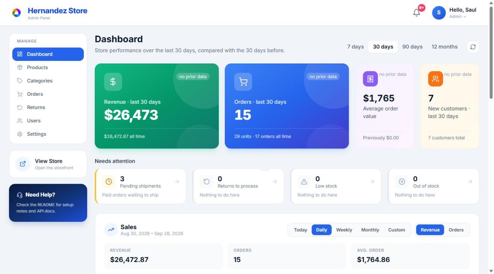
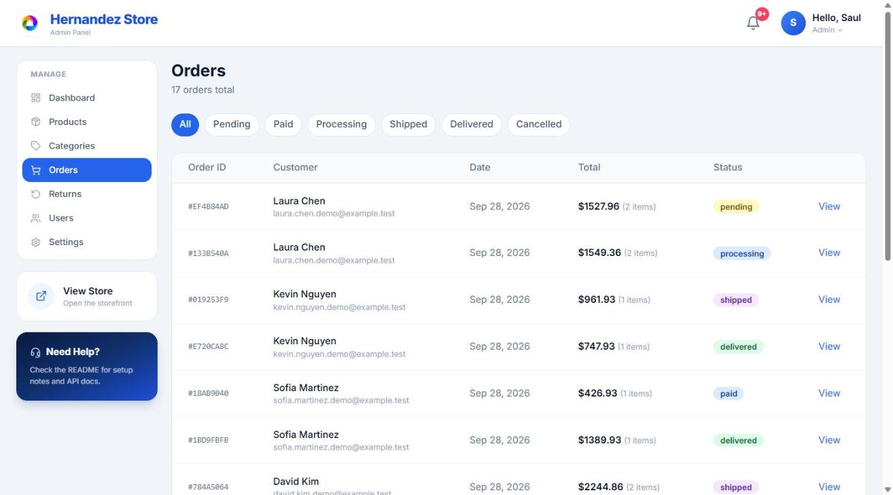
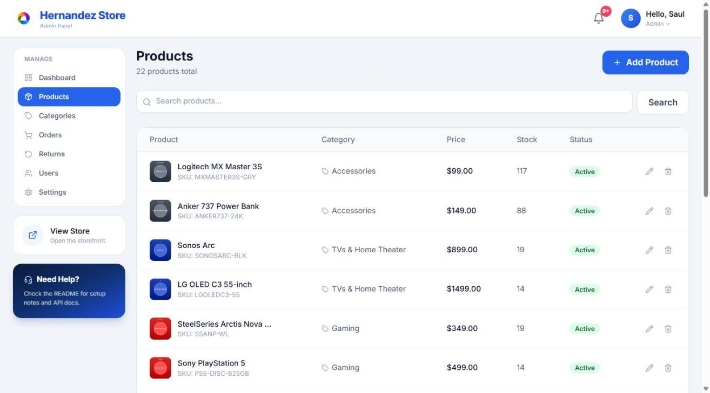
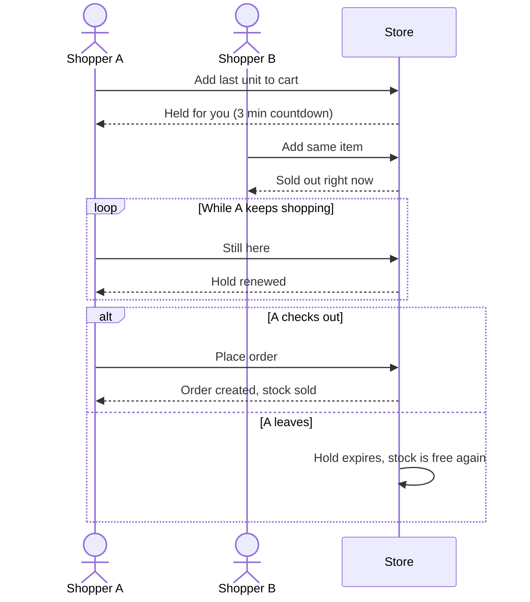
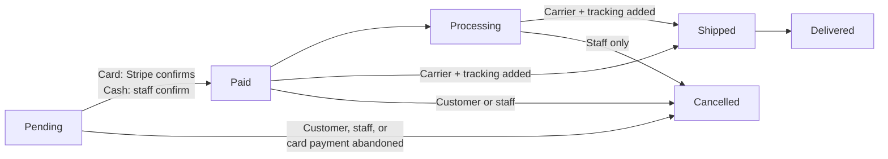
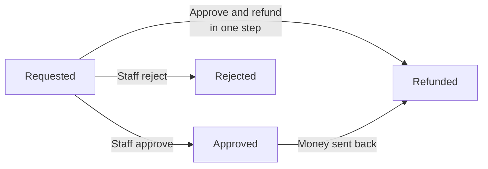
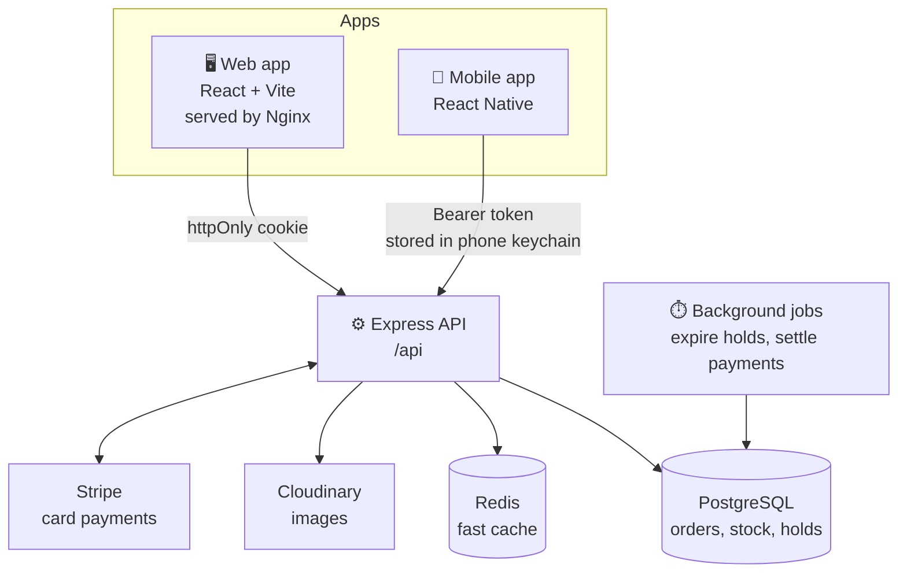

<div align="center">

# Ecommerce

**A complete online store: a shop for customers, a back office for staff, and a mobile app for both.**


</div>

---

## What is this?

A full online store built the way real shops need it to work, not a simple demo:

- **Customers** browse products, pick sizes and colors, add to cart, and pay by card or cash on delivery. They can cancel an order before it's prepared, track shipments, and request returns.
- **Staff** manage products, process orders, add tracking numbers, cancel orders, and handle returns and refunds.
- **Admins** also manage users and store settings, and see how sales are going.
- Everything works on the **web** and on a **mobile app** for iOS and Android, both talking to the same server.

**What makes it different:** two people can't buy the last item at the same time, a double-tap on "Place order" never creates two orders, abandoned card payments give their stock back on their own, and a refund can never be more than what the customer paid.

## Screenshots

| 🛍️ Storefront | 📊 Admin dashboard |
| --- | --- |
|  |  |
| **📦 Orders** | **🏷️ Products** |
|  |  |

<sub>Taken from a local copy filled with demo customers and orders.</sub>

## Contents

| Start here | How it works | Reference |
| --- | --- | --- |
| [What it does](#what-it-does) | [Shopping and stock holds](#shopping-and-stock-holds) | [Data model](#data-model) |
| [Who uses it](#who-uses-it) | [Orders and returns](#orders-and-returns) | [API endpoints](#api-endpoints) |
| [Run it locally](#run-it-locally) | [How it's built](#how-its-built) | [Environment variables](#environment-variables) |
| [Card payments](#card-payments-with-stripe) | [Security](#security) | [Project structure](#project-structure) |

---

## What it does

| Area | What you can do |
| --- | --- |
| 🛍️ **Catalog** | Browse by category and subcategory, search, and view photo galleries. The home page shows real best sellers (by units sold) and the newest arrivals. Products without a photo get a neutral "Photo coming soon" frame. |
| 🎨 **Product options** | Sell one product in many versions (for example color and size). Each version has its own SKU, stock, and optional price. |
| 🛒 **Cart** | Shop without an account. Adding a product opens a slide-out cart (also opened from the header icon) with the item, a few suggestions, and View cart / Checkout. Items are held for you for a few minutes, with a countdown. |
| 💳 **Checkout** | Pay by card through Stripe or choose cash on delivery. Tax is added from the store's settings. |
| 🚚 **Shipping** | Staff add the carrier and tracking number, and the customer gets a working tracking link. |
| ❌ **Cancellations** | Customers cancel their own order until the store starts preparing it; staff can cancel until it ships. Items go back on sale and a card payment is refunded automatically. |
| ↩️ **Returns** | Customers request a return for specific items of a delivered order, inside the store's return window. Staff approve, reject, or refund, and choose whether the items go back on sale. |
| 💸 **Refunds** | Card refunds go back through Stripe; cash-on-delivery refunds are recorded. Every order shows how much was refunded, and sales figures subtract it. |
| 🔔 **Notifications** | Customers get alerts for order, shipping, and return updates, with unread badges. |
| 🏷️ **Product management** | Add products, options, and versions. Upload up to 10 photos at a time and pick the main one. |
| 📦 **Order management** | Filter orders, move them through each status, and see full details. |
| 📊 **Dashboard** | Revenue, orders, units sold, average order, and new customers, each compared with the previous period. Low-stock and sold-out alerts, top products, pending shipments, and a sales chart. |
| ⚙️ **Store setup** | A first-run wizard sets the store name, logo, currency, tax rate, return window, and time zone. |
| 📱 **Mobile app** | The full shop and the full back office on iOS and Android. |

## Who uses it

| | 🛍️ Customer | 🧑‍💼 Staff | 👑 Admin |
| --- | :---: | :---: | :---: |
| Browse, cart, checkout | ✅ | ✅ | ✅ |
| Own orders, cancellations, returns, notifications | ✅ | ✅ | ✅ |
| Add and edit products and categories | | ✅ | ✅ |
| Delete products and categories | | | ✅ |
| Process, ship, and cancel orders | | ✅ | ✅ |
| Review returns and issue refunds | | ✅ | ✅ |
| Dashboard | | ✅ | ✅ |
| Manage users and roles | | | ✅ |
| Store setup and logo | | | ✅ |

Guests can browse and hold items in a cart without signing up. They sign in to place an order.

---

## Shopping and stock holds

When a shopper adds something to their cart, the store **sets that stock aside** for them. Nobody else can buy it while the hold lasts.



- Holds last **3 minutes** and renew on their own while the shopper is active.
- The database locks the row while it checks stock, so two people can never get the same last unit.
- A background job frees expired holds.
- If only part of a cart can be held, the banner shows which lines are short or sold out.
- **No double orders:** each checkout sends a unique key. If the request is repeated (bad signal, double-tap), the store returns the first result instead of making a second order. Keys are kept for 24 hours.

## Orders and returns

### Order



- Card orders move to **Paid** on their own once Stripe confirms the payment; staff can't mark them paid by hand. Cash-on-delivery orders are marked paid by staff.
- After that, staff move each order forward from the Orders page. The page only offers the next steps that are allowed, and a tracking number is required to mark an order shipped.
- If two people change the same order at once, the second one is told it changed and sees the latest version, instead of overwriting it.
- Card orders are confirmed by Stripe's signed message. If that's late, the store checks Stripe when the customer comes back, and a background job settles anything left open.
- An unpaid card checkout expires after 30 minutes and its stock goes back on sale.

### Cancellation

- **Customers** can cancel their own order while it's pending or paid, that is, until the store starts preparing it.
- **Staff** can cancel any order that hasn't shipped yet. Once shipped, problems are handled as returns.
- Cancelling puts every item back on sale. A paid card order is **refunded in full** through Stripe at the same moment. If Stripe refuses the refund, nothing changes and the order stays as it was.
- Cancelling an unpaid card order closes its Stripe checkout first, so it can't be paid afterwards.

### Return



- Only **delivered** orders can be returned (before that, the order is cancelled instead). There is one request per order, even if the customer taps twice.
- Requests must come within the store's return window (30 days by default, counted from the order date). Customers can pick which items and how many, never more than they bought.
- Staff can set the refund amount when approving and refund later, or do both at once. A refund can't be more than what's left of the order total after earlier refunds.
- Card orders are refunded to the card through Stripe. For cash on delivery, staff give the money back themselves and the store records it.
- When refunding, staff choose whether the returned items go back on sale (untick it for damaged items).
- Rejected and refunded returns are final. The customer is notified at each step.

---

## How it's built

One API serves both apps, so the web and the phone always follow the same rules.



| Layer | Technology |
| --- | --- |
| Web | React 18, TypeScript, Vite 8, Redux Toolkit, React Router 7, Tailwind CSS 4, Axios, Recharts |
| Mobile | React Native 0.87 (React 19), TypeScript, React Navigation, Redux Toolkit, react-native-keychain |
| API | Node.js, Express 4, JWT, bcrypt, Helmet, express-rate-limit, Multer |
| Data | PostgreSQL 16, Redis 7 |
| Payments | Stripe Checkout and webhooks |
| Images | Cloudinary (local disk in development) |
| Infrastructure | Docker Compose, Node 24 LTS images, Nginx (unprivileged) |
| Tooling | nodemon, ESLint, Prettier; tests with Node's test runner (API), Vitest (web), and Jest (mobile) |

**Speed:** busy pages (products, categories, dashboard) are cached in Redis and cleared the moment something changes. Product pages cache for only 30 seconds because they show live stock. The website loads the back office only for staff, so shoppers download about a third as much code.

## Security

| Protection | How it works |
| --- | --- |
| 🔑 Passwords | Stored only as bcrypt hashes |
| 🍪 Web sign-in | Token in an httpOnly cookie that page scripts can't read, valid 7 days |
| 📱 Phone sign-in | Token kept in the iOS or Android keychain |
| 🚦 Rate limits | Sign-in: 10 tries per 15 minutes. Place order: 10 per minute. Cart sync: 120 per minute. |
| 🖼️ Uploads | Files are checked by their real content, not just their name, before they're accepted |
| 🪖 Headers | Helmet security headers and CORS limited to the store's own site |
| 💳 Stripe | Every payment message is signature-checked before it counts |
| 🙈 Errors | Server errors never leak internal details to the browser. Malformed IDs and page numbers get a clean "not found" or a sensible default, never a crash |
| 🔐 Secrets | The server won't start without its sign-in secret, and Docker won't start without the database, Redis, and sign-in secrets. There are no built-in defaults |
| 🚪 Single entrance | From outside the machine, the API is reached only through the website's proxy, so nobody can fake their address to get around the rate limits |
| 🐳 Containers | Every container runs as a non-root user, with `no-new-privileges` and health checks |

---

## Run it locally

### Option 1: Docker (easiest)

**You need:** Docker and Docker Compose.

```bash
git clone https://github.com/sahc1987/Ecommerce.git
cd Ecommerce
cp .env.example .env
# Fill in DB_PASSWORD, REDIS_PASSWORD and JWT_SECRET in .env.
# Generate each one with: openssl rand -hex 32
docker compose up --build
```

This starts the database, Redis, the API, and the website. Docker won't start while any of those three secrets is empty, so a copied example can never run with a known password. The first time, the site sends you to **`/setup`** to name your store.

### Option 2: Run each part yourself

<details>
<summary><b>Backend, web, and mobile commands</b></summary>

**Backend** (needs PostgreSQL and Redis running)

```bash
cd backend
cp .env.example .env
npm install
npm run db:init   # create the tables
npm run dev       # http://localhost:5000
```

Run `npm run db:init` again after pulling new changes. It's safe to repeat and brings an existing database up to date. With Docker this happens on its own each time the API starts.

**Web**

```bash
cd frontend
cp .env.example .env
npm install
npm run dev       # http://localhost:5173
```

**Mobile** (needs Android Studio or Xcode set up for React Native, Node 22+)

```bash
cd mobile
npm install
npm run ios       # or: npm run android
```

</details>

### Run the tests

```bash
cd backend && npm test      # business rules, plus the API tests when TEST_DATABASE_URL is set
cd frontend && npm test     # web: data loading, prices and product versions
cd mobile && npm test       # mobile: cart rules, product versions, app start
```

The backend's API tests place real orders, cancel them, and process returns and refunds against a database of their own. Create an empty database whose name contains `test` (for example `ecommerce_test`) and point `TEST_DATABASE_URL` at it. **Everything in it is erased on each run**, which is why a database without `test` in its name is refused. Without the variable, only the tests that need no database run.

`npm run lint` checks the web and mobile code, and `npm run typecheck` (web) or `npx tsc --noEmit` (mobile) checks the types.

## Card payments with Stripe

Card payments are optional. Without Stripe keys, checkout offers **cash on delivery** only.

1. Copy your test secret key (`sk_test_…`) from the [Stripe dashboard](https://dashboard.stripe.com/test/apikeys) into `STRIPE_SECRET_KEY`.
2. Send Stripe events to `/api/payments/webhook` and put the signing secret in `STRIPE_WEBHOOK_SECRET`. Locally, the Stripe CLI does both:

   ```bash
   stripe listen --forward-to localhost:5000/api/payments/webhook   # prints whsec_…
   ```

   Events used: `checkout.session.completed`, `checkout.session.async_payment_succeeded`, `checkout.session.async_payment_failed`, `checkout.session.expired`.
3. Restart the backend and pay with test card **4242 4242 4242 4242**, any future date, any CVC.

The webhook isn't strictly needed locally: the store also checks payment when the customer returns, and a background job settles the rest.

---

## Reference

<details>
<summary><b>Data model</b> (16 tables)</summary>

### Data model

| Group | Table | Holds |
| --- | --- | --- |
| Store | `store_settings` | Name, logo, currency, tax rate, return window, time zone |
| People | `users` | Account and role (`admin`, `staff`, `customer`) |
| Catalog | `categories` / `subcategories` | How products are organized |
| | `products` | Name, description, base price, category |
| | `product_images` | Photos, with one marked as main |
| | `product_options` | Choices a product offers, like Color → Red, Blue |
| | `product_variants` | Each sellable version: SKU, stock, optional price |
| Selling | `stock_reservations` | Cart holds and when they expire |
| | `orders` / `order_items` | Orders, payment status, amount refunded, tracking, and line items |
| | `idempotency_keys` | Saved checkout results so repeats don't double-order |
| Returns | `returns` / `return_items` | Return requests (one per order), the items in them, and whether they were restocked |
| Alerts | `notifications` | Customer messages and read state |
| History | `legacy_product_stock_sku` | Backup of old stock and SKU data from before product options |

**Order status:** `pending` → `paid` → `processing` → `shipped` → `delivered`, or `cancelled` (before shipping).
**Payment status:** `unpaid`, `paid`, `canceled`, `partially_refunded`, `refunded`.
**Return status:** `requested` → `approved` / `rejected` / `refunded`, and `approved` → `refunded`.

Schema: [`backend/src/db/schema.sql`](./backend/src/db/schema.sql). Changes: [`backend/src/db/migrations`](./backend/src/db/migrations).

</details>

<details>
<summary><b>API endpoints</b></summary>

### API endpoints

All paths start with `/api`. 🔒 = signed in, 🧑‍💼 = staff or admin, 👑 = admin only.

**Sign-in**

| Method | Path | Does |
| --- | --- | --- |
| POST | `/auth/register` | Create an account |
| POST | `/auth/login` | Sign in |
| POST | `/auth/logout` | Sign out |
| GET | `/auth/me` | Who am I 🔒 |

**Store setup**

| Method | Path | Does |
| --- | --- | --- |
| GET | `/setup/status` | Is the store set up? |
| POST | `/setup/complete` | Save store settings 👑 |
| POST | `/setup/logo` | Upload the logo 👑 |

**Catalog**

| Method | Path | Does |
| --- | --- | --- |
| GET | `/categories` | All categories |
| GET | `/categories/:id/subcategories` | Subcategories of one |
| POST, PUT | `/categories`, `/categories/:id` | Add or edit 🧑‍💼 |
| DELETE | `/categories/:id` | Delete 👑 |
| POST, PUT | `/categories/:categoryId/subcategories`, `/categories/subcategories/:id` | Add or edit subcategory 🧑‍💼 |
| DELETE | `/categories/subcategories/:id` | Delete subcategory 👑 |
| GET | `/products` | Browse and search, with live stock and units sold. `sort=new` (default) or `sort=popular` (best sellers) |
| GET | `/products/:idOrSlug` | One product |
| GET | `/products/admin/all`, `/products/admin/:id` | Back-office views 🧑‍💼 |
| POST, PUT | `/products`, `/products/:id` | Add or edit 🧑‍💼 |
| PUT | `/products/:id/variants/:variantId` | Edit one version 🧑‍💼 |
| DELETE | `/products/:id` | Delete 👑 |
| POST | `/products/:id/images` | Upload photos (up to 10) 🧑‍💼 |
| DELETE | `/products/:id/images/:imageId` | Remove a photo 🧑‍💼 |
| PUT | `/products/:id/images/:imageId/primary` | Set main photo 🧑‍💼 |

**Cart holds** (guests use the `X-Cart-Token` header)

| Method | Path | Does |
| --- | --- | --- |
| GET | `/reservations` | My current holds |
| PUT | `/reservations` | Sync the cart and hold stock |
| POST | `/reservations/renew` | Keep holds alive |
| DELETE | `/reservations/:id?` | Release one hold or all |

**Checkout and orders**

| Method | Path | Does |
| --- | --- | --- |
| POST | `/payments/place-order` | Place an order (send an `Idempotency-Key`) 🔒 |
| GET | `/payments/config` | Is card payment on? |
| GET | `/payments/return` | Back from Stripe: check payment |
| POST | `/payments/:id/confirm`, `/payments/:id/cancel` | Confirm or cancel a card payment 🔒 |
| POST | `/payments/webhook` | Stripe events (signature checked) |
| GET | `/orders`, `/orders/:id` | My orders, or all for staff, with the actions allowed next 🔒 |
| POST | `/orders/:id/cancel` | Cancel my own order (refunds a card payment) 🔒 |
| PUT | `/orders/:id/status` | Change status, add tracking, or cancel. Send `expected_status` to avoid overwriting someone else's change 🧑‍💼 |

**Returns**

| Method | Path | Does |
| --- | --- | --- |
| GET | `/returns`, `/returns/:id` | My returns, or all for staff 🔒 |
| POST | `/returns` | Ask for a return 🔒 |
| PUT | `/returns/:id` | Approve, reject, or refund, with the amount and whether to restock 🧑‍💼 |

**Dashboard** 🧑‍💼

| Method | Path | Does |
| --- | --- | --- |
| GET | `/dashboard/summary` | Totals vs. previous period, stock alerts |
| GET | `/dashboard/top-products` · `/recent-orders` · `/sales-chart` · `/low-stock` · `/pending-shipments` | Dashboard panels |

**Users** 👑 and **notifications** 🔒

| Method | Path | Does |
| --- | --- | --- |
| GET | `/users`, `/users/:id` | List or view users |
| PUT, DELETE | `/users/:id` | Edit role or remove |
| GET | `/notifications` | My notifications |
| PUT | `/notifications/:id/read`, `/notifications/read-all` | Mark as read |
| DELETE | `/notifications/:id` | Delete one |
| GET | `/health` | Server is up |

</details>

<details>
<summary><b>Environment variables</b></summary>

### Environment variables

Each part has its own `.env.example`. Copy it to `.env` and fill it in.

**Backend** (`backend/.env`)

| Variable | Needed? | What it's for |
| --- | --- | --- |
| `PORT` | Optional | API port (default 5000) |
| `DATABASE_URL` | ✅ Yes | PostgreSQL connection |
| `REDIS_URL` | ✅ Yes | Redis connection |
| `JWT_SECRET` | ✅ Yes | Signs sign-in tokens. Use a long random value (`openssl rand -hex 32`). The server won't start without it |
| `CLIENT_URL` | ✅ Yes | The website address allowed to call the API |
| `CROSS_SITE_COOKIES` | Optional | `true` when the website and API are on different domains |
| `CLOUDINARY_CLOUD_NAME` / `_API_KEY` / `_API_SECRET` | Optional | Store images in Cloudinary. Without them, images save to disk (development only) |
| `CLOUDINARY_FOLDER` | Optional | Cloudinary folder (default `ecommerce`) |
| `STRIPE_SECRET_KEY` | Optional | Turns on card payments |
| `STRIPE_WEBHOOK_SECRET` | With Stripe | Verifies Stripe messages |

**Web** (`frontend/.env`)

| Variable | What it's for |
| --- | --- |
| `VITE_API_URL` | API address. Leave empty to use `/api` on the website's own address (the default, and what Docker uses). Set a full URL like `https://api.example.com/api` only when the API is on another domain |

**Docker Compose** (`.env` in the root)

| Variable | What it's for |
| --- | --- |
| `DB_NAME` / `DB_USER` / `DB_PASSWORD` / `DB_PORT` | Database container (`DB_PASSWORD` required) |
| `REDIS_PASSWORD` | Redis container (required) |
| `BACKEND_PORT` / `FRONTEND_PORT` | Ports on your machine. The database and API ports only accept connections from this machine; the website port is the public one |
| `NODE_ENV`, `JWT_SECRET` (required), `CLIENT_URL`, `VITE_API_URL`, `TZ` | Passed to the apps |
| `STRIPE_SECRET_KEY` / `STRIPE_WEBHOOK_SECRET` | Card payments |

</details>

<details>
<summary><b>Project structure</b></summary>

### Project structure

```
Ecommerce/
├── backend/               Express API
│   ├── src/
│   │   ├── routes/        auth, setup, categories, products, orders, payments,
│   │   │                  stripeWebhook, reservations, returns, dashboard,
│   │   │                  users, notifications
│   │   ├── middleware/    sign-in and roles, upload checks, no-double-orders
│   │   ├── utils/         order status rules, cancellations, refunds, restocking,
│   │   │                  stock holds, cache, Stripe orders, product versions,
│   │   │                  notifications, request checks, safe errors
│   │   ├── db/            schema.sql and migrations
│   │   └── config/        PostgreSQL, Redis, Stripe, Cloudinary
│   └── test/              unit tests (rules) and API tests (real database)
├── frontend/              React web app (shop + back office)
│   └── src/
│       ├── pages/         Shop, Admin, Auth, Setup wizard
│       ├── components/    layouts, product cards, cart, hold banner,
│       │                  version picker and editor, sales chart
│       ├── store/         Redux (cart, auth)
│       ├── hooks/         useApiGet (loading data), useReservations
│       │                  (holds and countdown)
│       └── types.ts       shapes of orders, returns and users from the API
├── mobile/                React Native app (iOS + Android)
│   └── src/
│       ├── screens/       Shop and Admin screens, same as the web
│       ├── components/    product card, hold notice, version editor
│       ├── navigation/    stack and tab navigation
│       ├── store/         Redux (cart, auth, settings)
│       └── hooks/         hold sync, unread count
├── docs/screenshots/      README images
└── docker-compose.yml     PostgreSQL, Redis, API, website (Nginx)
```

</details>

---

<div align="center">

Built by **Saúl Hernández** · [GitHub](https://github.com/sahc1987) · [LinkedIn](https://linkedin.com/in/saul-hernandez-dev) · [Email](mailto:sahc1987@gmail.com)

<sub>No license yet. All rights reserved by the author.</sub>

</div>
